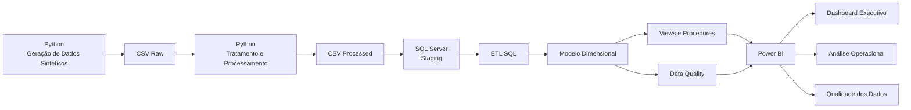
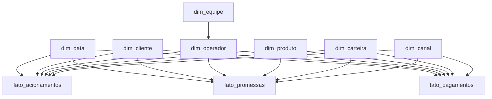
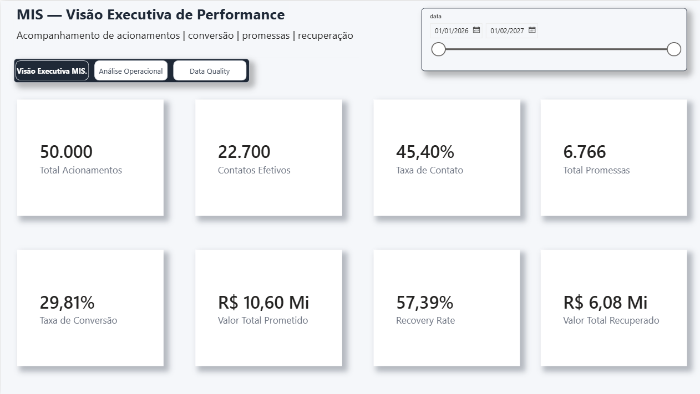
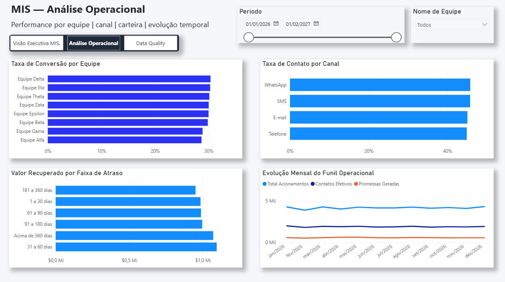
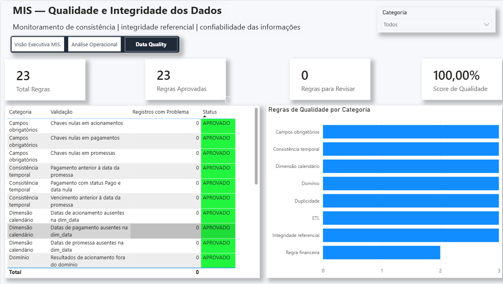

# 📊 MIS — Performance Operacional e Recuperação de Crédito


### 🔗 Acesso rápido

- 📊 [Dashboard Power BI](powerbi/MIS_EXSEN_Dashboard.pbix)
- 🐍 [Scripts Python](python/)
- 🗄️ [Scripts SQL](sql/)
- 🖼️ [Imagens do Dashboard](docs/images/)

Projeto end-to-end de **Management Information System (MIS)** aplicado a uma operação simulada de cobrança e contact center, integrando **Python, SQL Server, modelagem dimensional, ETL, Data Quality e Power BI** para transformar dados operacionais em indicadores gerenciais e informações para tomada de decisão.

> **Nota de transparência:** este é um projeto demonstrativo de portfólio, desenvolvido com finalidade educacional e profissional.  
> Os dados utilizados são **100% sintéticos** e não representam informações reais da Exsen ou de qualquer outra empresa.  
> O projeto não possui vínculo oficial com a Exsen Excelência em Serviços.

---

## 🎯 Visão Executiva

O projeto simula uma estrutura de MIS responsável pelo acompanhamento de uma operação de cobrança, desde os **acionamentos realizados pelos operadores** até a **recuperação financeira da carteira**.

A solução foi desenvolvida para responder à seguinte pergunta de negócio:

> **Como transformar dados operacionais de uma operação de cobrança em indicadores confiáveis, automatizados e acionáveis para acompanhamento de performance e tomada de decisão?**

O fluxo desenvolvido contempla:

- geração de dados sintéticos;
- preparação e tratamento com Python;
- carga em área de staging;
- modelagem dimensional em SQL Server;
- validações de qualidade e integridade dos dados;
- criação de views e procedures;
- definição de KPIs;
- construção de dashboard executivo e operacional no Power BI.

---

# 💼 Cenário de Negócio

Operações de cobrança e contact center geram grandes volumes de informações diariamente:

- tentativas de contato;
- contatos efetivos;
- promessas de pagamento;
- pagamentos;
- canais de atendimento;
- operadores;
- equipes;
- produtos;
- carteiras;
- faixas de atraso.

Esses dados isolados possuem pouco valor gerencial.

O papel do MIS é consolidar essas informações em indicadores capazes de responder perguntas como:

- Qual é a taxa de contato da operação?
- Quais equipes possuem maior conversão?
- Quais canais apresentam melhor desempenho?
- Quanto foi prometido pelos clientes?
- Quanto foi efetivamente recuperado?
- Qual faixa de atraso concentra maior recuperação?
- Como o funil operacional evolui ao longo do tempo?
- Os dados utilizados pelo dashboard estão íntegros e confiáveis?

---

# 🏗️ Arquitetura da Solução



---

# 🔄 Pipeline de Dados

O projeto utiliza uma arquitetura em camadas.

### 1️⃣ Geração

Os dados são gerados com Python para simular uma operação de cobrança contendo clientes, operadores, acionamentos, promessas e pagamentos.

### 2️⃣ Raw

Os arquivos originais são armazenados em:

```text
data/raw/
```

### 3️⃣ Processamento

Python realiza preparação e padronização dos datasets antes da carga.

Arquivos tratados são armazenados em:

```text
data/processed/
```

### 4️⃣ Staging

Os dados processados são carregados para tabelas `stg_*` no SQL Server.

### 5️⃣ Modelo Dimensional

A camada dimensional organiza os dados utilizando dimensões e tabelas fato.

### 6️⃣ Camada Analítica

Views, stored procedures e consultas SQL disponibilizam informações consolidadas para análise.

### 7️⃣ Visualização

O Power BI consome o modelo e apresenta indicadores executivos, operacionais e de qualidade.

---

# ⭐ Modelagem Dimensional

O modelo foi estruturado utilizando conceitos de **Star Schema**, separando entidades descritivas das informações transacionais.

## Dimensões

```text
dim_data
dim_cliente
dim_operador
dim_equipe
dim_produto
dim_carteira
dim_canal
```

## Tabelas Fato

```text
fato_acionamentos
fato_promessas
fato_pagamentos
```

Relacionamento conceitual:



---

# 📊 Volume de Dados

O cenário sintético utilizado no projeto contém:

| Dataset | Registros |
|---|---:|
| Clientes | 10.000 |
| Operadores | 80 |
| Equipes | 8 |
| Produtos | 5 |
| Carteiras / Faixas | 6 |
| Canais | 4 |
| Calendário | 397 |
| Acionamentos | 50.000 |
| Promessas | 6.766 |
| Pagamentos | 5.358 |

Período da dimensão calendário:

```text
01/01/2026 até 01/02/2027
```

---

# 📈 KPIs do Projeto

Os principais indicadores construídos foram:

### Total de Acionamentos

Quantidade total de tentativas registradas pela operação.

### Contatos Efetivos

Quantidade de acionamentos nos quais houve contato efetivo com o cliente.

### Taxa de Contato

```text
Contatos Efetivos / Total de Acionamentos
```

### Promessas Geradas

Quantidade de contatos que resultaram em promessa de pagamento.

### Taxa de Conversão

```text
Promessas Geradas / Contatos Efetivos
```

### Valor Total Prometido

Somatório financeiro das promessas realizadas pelos clientes.

### Valor Total Recuperado

Somatório dos pagamentos efetivamente realizados.

### Recovery Rate

```text
Valor Recuperado / Valor Prometido
```

---

# 📌 Resultado Geral do Cenário

Após processamento e consolidação dos dados:

| Indicador | Resultado |
|---|---:|
| Total de Acionamentos | 50.000 |
| Contatos Efetivos | 22.700 |
| Taxa de Contato | 45,40% |
| Total de Promessas | 6.766 |
| Taxa de Conversão | 29,81% |
| Valor Total Prometido | R$ 10,60 milhões |
| Valor Total Recuperado | R$ 6,08 milhões |
| Recovery Rate | 57,39% |

> Os resultados acima pertencem exclusivamente ao cenário sintético desenvolvido neste projeto.

---

# 🧮 Principais Medidas DAX

Exemplo de algumas das medidas utilizadas no Power BI.

### Total de Acionamentos

```DAX
Total Acionamentos =
COUNTROWS(fato_acionamentos)
```

### Contatos Efetivos

```DAX
Contatos Efetivos =
CALCULATE(
    COUNTROWS(fato_acionamentos),
    fato_acionamentos[contato_efetivo] = 1
)
```

### Taxa de Contato

```DAX
Taxa de Contato =
DIVIDE(
    [Contatos Efetivos],
    [Total Acionamentos],
    0
)
```

### Taxa de Conversão

```DAX
Taxa de Conversão =
DIVIDE(
    [Promessas Geradas],
    [Contatos Efetivos],
    0
)
```

### Valor Total Recuperado

```DAX
Valor Total Recuperado =
CALCULATE(
    SUM(fato_pagamentos[valor_pago]),
    fato_pagamentos[status_pagamento] = "Pago"
)
```

### Recovery Rate

```DAX
Recovery Rate =
DIVIDE(
    [Valor Total Recuperado],
    [Valor Total Prometido],
    0
)
```

---

# 🛡️ Data Quality

Além do acompanhamento de performance, foi criada uma camada específica para verificar a confiabilidade dos dados antes de sua utilização gerencial.

Foram implementadas **23 regras de qualidade**, distribuídas entre diferentes categorias:

- Campos obrigatórios;
- Duplicidade;
- Integridade referencial;
- Consistência temporal;
- Domínio;
- Regra financeira;
- Dimensão calendário;
- ETL.

A auditoria verifica situações como:

```text
IDs duplicados
Chaves nulas
Foreign Keys inexistentes
Valores financeiros inválidos
Datas inconsistentes
Status fora do domínio esperado
Datas inexistentes na dimensão calendário
Diferenças entre staging e modelo dimensional
```

Resultado final da auditoria:

| Indicador | Resultado |
|---|---:|
| Regras executadas | 23 |
| Regras aprovadas | 23 |
| Regras para revisão | 0 |
| Score de Qualidade | 100% |

---

# ⚙️ SQL Server

O SQL Server é utilizado como camada central de armazenamento, transformação e disponibilização analítica.

Foram desenvolvidos:

- tabelas de staging;
- dimensões;
- tabelas fato;
- relacionamentos;
- constraints;
- índices;
- views;
- stored procedures;
- auditoria de Data Quality;
- processos de carga entre staging e modelo dimensional.

---

# 👁️ Views Analíticas

Foram criadas quatro views para facilitar o consumo das informações:

```sql
vw_acionamentos_operacional
vw_promessas_operacional
vw_pagamentos_operacional
vw_performance_operacional
```

Também foi criada:

```sql
vw_data_quality
```

para disponibilizar o resultado das verificações de qualidade diretamente ao Power BI.

---

# 🔧 Stored Procedure

O projeto contém a procedure:

```sql
dbo.sp_resumo_mis
```

Ela permite gerar uma visão consolidada da operação utilizando intervalo de datas.

Exemplo:

```sql
EXEC dbo.sp_resumo_mis
    @DataInicio = '2026-01-01',
    @DataFim = '2026-12-31';
```

A procedure retorna indicadores como:

```text
Total de Acionamentos
Contatos Efetivos
Taxa de Contato
Promessas
Taxa de Conversão
Valor Prometido
Valor Recuperado
```

---

# 📊 Dashboard Power BI

O dashboard foi dividido em três perspectivas.

## 1️⃣ Visão Executiva MIS

Foco no acompanhamento dos principais indicadores da operação.



Principais KPIs:

```text
Total de Acionamentos
Contatos Efetivos
Taxa de Contato
Total de Promessas
Taxa de Conversão
Valor Total Prometido
Valor Total Recuperado
Recovery Rate
```

---

## 2️⃣ Análise Operacional

Permite analisar performance por diferentes dimensões do negócio.



Análises disponíveis:

- Taxa de Conversão por Equipe;
- Taxa de Contato por Canal;
- Valor Recuperado por Faixa de Atraso;
- Evolução Mensal do Funil Operacional;
- Filtro por equipe;
- Filtro por período.

---

## 3️⃣ Qualidade e Integridade dos Dados

Página dedicada ao acompanhamento da confiabilidade do modelo.



Indicadores:

```text
Total de Regras
Regras Aprovadas
Regras para Revisar
Score de Qualidade
```

Também é possível analisar cada validação individualmente e filtrar as regras por categoria.

---

# 💡 Análises Possíveis

A arquitetura permite investigar diferentes aspectos da operação, como:

### Performance de Equipes

Comparar a taxa de conversão entre equipes e identificar diferenças de produtividade operacional.

### Eficiência dos Canais

Avaliar quais canais possuem maior capacidade de geração de contato e conversão.

### Recuperação por Faixa de Atraso

Identificar quais carteiras concentram maior volume financeiro recuperado.

### Funil Operacional

Acompanhar a evolução:

```text
Acionamentos
      ↓
Contatos Efetivos
      ↓
Promessas
      ↓
Pagamentos
      ↓
Valor Recuperado
```

### Qualidade dos Dados

Garantir que decisões gerenciais sejam tomadas utilizando informações consistentes e auditáveis.

---

# 📁 Estrutura do Projeto

```text
MIS_EXSEN_PROJECT/
│
├── data/
│   ├── raw/
│   └── processed/
│
├── python/
│   ├── 01_criar_dim_operador.py
│   ├── 02_criar_dim_equipe.py
│   ├── 03_criar_dim_produto.py
│   ├── 04_criar_dim_carteira.py
│   ├── 05_criar_dim_canal.py
│   ├── 06_criar_dim_data.py
│   ├── 07_criar_dim_cliente.py
│   ├── 08_criar_fato_acionamentos.py
│   ├── 09_criar_fato_promessas.py
│   ├── 10_criar_fato_pagamentos.py
│   ├── 11_validar_qualidade_dados.py
│   ├── 12_processar_staging.py
│   ├── 13_testar_conexao_sqlserver.py
│   └── 14_carregar_staging_sqlserver.py
│
├── sql/
│   ├── 01_staging.sql
│   ├── 02_dimensions.sql
│   ├── 03_facts.sql
│   ├── 04_relationships.sql
│   ├── 05_indexes.sql
│   ├── 06_views.sql
│   ├── 07_kpis.sql
│   ├── 08_data_quality.sql
│   ├── 09_carga_modelo.sql
│   ├── 10_procedures.sql
│   └── 11_view_data_quality.sql
│
├── powerbi/
│   └── MIS_EXSEN_Dashboard.pbix
│
├── docs/
│   └── images/
│       ├── dashboard_executivo.png
│       ├── dashboard_operacional.png
│       └── dashboard_data_quality.png
│
├── presentation/
│
└── README.md
```

---

# 🛠️ Stack Tecnológica

### Banco de Dados

- SQL Server
- T-SQL
- SQL Server Management Studio

### Business Intelligence

- Power BI
- DAX
- Power Query
- Modelagem Dimensional

### Programação e ETL

- Python
- Pandas
- NumPy
- PyODBC

### Engenharia e Qualidade

- ETL
- Star Schema
- Data Quality
- Integridade Referencial
- Views
- Stored Procedures
- Indexação

### Desenvolvimento

- VS Code
- Git
- GitHub

---

# ▶️ Fluxo de Execução

O pipeline pode ser reproduzido seguindo a sequência abaixo.

### 1. Gerar dimensões

```bash
python python/01_criar_dim_operador.py
python python/02_criar_dim_equipe.py
python python/03_criar_dim_produto.py
python python/04_criar_dim_carteira.py
python python/05_criar_dim_canal.py
python python/06_criar_dim_data.py
python python/07_criar_dim_cliente.py
```

### 2. Gerar fatos

```bash
python python/08_criar_fato_acionamentos.py
python python/09_criar_fato_promessas.py
python python/10_criar_fato_pagamentos.py
```

### 3. Processar dados

```bash
python python/12_processar_staging.py
```

### 4. Criar estrutura SQL

Executar:

```text
01_staging.sql
02_dimensions.sql
03_facts.sql
04_relationships.sql
05_indexes.sql
06_views.sql
```

### 5. Carregar staging

```bash
python python/14_carregar_staging_sqlserver.py
```

### 6. Carregar modelo dimensional

Executar:

```text
09_carga_modelo.sql
```

### 7. Validar qualidade

Executar:

```text
08_data_quality.sql
11_view_data_quality.sql
```

### 8. Criar camada analítica

Executar:

```text
07_kpis.sql
10_procedures.sql
```

### 9. Power BI

Abrir:

```text
powerbi/MIS_EXSEN_Dashboard.pbix
```

e atualizar as fontes de dados.

---

# 🧠 Competências Demonstradas

Este projeto foi desenvolvido para demonstrar competências importantes em uma rotina de MIS:

- interpretação de necessidades de negócio;
- desenvolvimento de KPIs operacionais;
- SQL intermediário/avançado;
- criação de views e stored procedures;
- modelagem dimensional;
- processos de ETL;
- automação com Python;
- tratamento e validação de dados;
- Data Quality;
- Power BI;
- DAX;
- análise operacional;
- visualização de dados;
- documentação técnica;
- transformação de dados em informação gerencial.

---

# ⚠️ Limitações

Este projeto possui algumas limitações intencionais.

- Os dados são sintéticos e não representam uma operação real.
- Os padrões de comportamento foram simulados para fins demonstrativos.
- O ambiente foi construído localmente em SQL Server.
- Não existe atualização em tempo real.
- O modelo não utiliza dados pessoais reais.
- Indicadores e regras de negócio podem variar significativamente em uma operação de produção.

Em um ambiente corporativo, o mesmo conceito poderia ser expandido com:

```text
SQL Server Agent
SSIS
APIs
Data Warehouse corporativo
Incremental Refresh
Row-Level Security
Monitoramento de SLA
Alertas automáticos
Orquestração de pipelines
Controle de acesso
Logs de execução
```

---

# 🚀 Próximas Evoluções

- [ ] Criar carga incremental em vez de carga completa
- [ ] Automatizar execução dos scripts Python
- [ ] Implementar logs de ETL
- [ ] Adicionar controle de SLA das cargas
- [ ] Criar alertas automáticos de Data Quality
- [ ] Implementar Row-Level Security no Power BI
- [ ] Criar análise de produtividade por operador
- [ ] Desenvolver segmentação de clientes por comportamento
- [ ] Criar previsão de recuperação da carteira
- [ ] Implementar pipeline automatizado de atualização

---

# 👤 Autor

**Victor Hugo Miranda Crispim**

Bacharel em Análise de Dados — EBAC

Foco profissional em:

```text
Data Analytics
Business Intelligence
MIS
SQL
Power BI
Python
Análise de Performance
Crédito e Cobrança
```

LinkedIn:  
https://www.linkedin.com/in/victorhugocrispim

GitHub:  
https://github.com/engvictortech

---

## 📌 Sobre o Projeto

Este projeto foi desenvolvido como demonstração prática de uma solução de **MIS aplicada a operações de cobrança e contact center**, integrando o ciclo completo de dados:

> **geração → tratamento → armazenamento → modelagem → validação → análise → visualização.**

O objetivo não foi apenas construir um dashboard, mas demonstrar como uma estrutura de dados pode ser organizada para entregar **informações confiáveis, auditáveis e úteis para a gestão operacional**.
